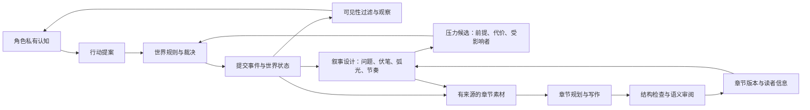

# ADR 001：世界运行与小说创作双核心（第一阶段）

状态：第一阶段已实施。范围：可靠性、可审计数据边界、最小叙事状态与诊断。用户数据只读。

## 判断与证据

保留仓库作为渐进重构基础。engine 已有 Proposal/LogEntry/Replay；sim 已有观察包、独立记忆、导演弧线、伏笔与快照；novel 已有分章、章节叙事规划和导出。并非从零补一个“导演”。现有模块缺少统一的证据、权限和持久化契约。

已确认缺陷：配置以不完整结构覆盖；主角从 map 任取；读取列表调用 LLM 并导出；生成前删除章节；忽略截断原因并用标题冒充摘要；状态先变更后写日志；观察和提案被无差别转成公开 FACT。现有就绪度把弧线计数、模型标注的伏笔回收和张力当作小说质量，不能验证因果与读者体验。

## 决策

在同一 Go 进程中建立模块边界，暂不拆微服务。世界裁决拥有事实写权限；角色仅消费获准观察与自己的认知；叙事引擎拥有作者计划和读者信息；写手产出版本化作品。作者计划不是角色知识，读者知道也不等于角色知道。

世界事实、角色信念、读者信息、作者意图使用不同类型。作者计划支持主题、核心问题、秘密、伏笔生命周期、人物弧光、冲突升级和下一步条件；所有已兑现声明必须关联事件或已发布章节。允许安静场景、情感变化和延迟揭示，不强制每章高潮或每轮反转。停滞指标是诊断信号，不是文学分数。

章节结束标记、摘要完整、finish_reason、事件引用可自动检查；文笔、因果合理性、伏笔公平性与反转效果不能靠正则或一个分数证明。第一阶段记录证据与待审状态，不声称已经实现全自动文学质量判断。

## 追踪与执行计划

| ID | 优先级/层 | 问题与最小改动 | 验证 |
|---|---|---|---|
| R01 | P0 配置 | 部分更新保留未提交字段；独立写作覆盖配置 | 两个保存入口省略字段仍保留 |
| R02 | P0 身份 | 显式主角/视角；唯一旧标记只读兼容；歧义报错 | 多实体顺序无关、缺失拒绝运行 |
| R03 | P0/P2 写作 | 截断/缺摘要/结束标记拒绝发布；版本保存 | mock 返回失败不污染正式章节 |
| R04 | P0 写作 | 持久分章、纯读列表、增量/安全重试 | GET 零调用，重复生成保留文件 |
| R05 | P0 事实 | 副本校验后写日志再提交；拒绝空实体路径 | 原子失败、重放一致 |
| R06 | P1 认知 | 角色输入过滤、证据类型与权限 | 私密信息不会进其他角色输入 |
| R07 | P1 叙事 | 持久状态、推进证据、停滞与压力候选 | 固定事件的推进/重复/未知判别 |
| R08 | P2 素材 | 章节来源、读者信息与伏笔状态关联 | 来源缺失、未来摘要不注入 |
| R09 | P0 诊断 | 白室协议只读报告与迁移建议 | 源文件哈希不变 |

先完成可靠性，再接通最小叙事骨架，最后验证与输出诊断。现有 main.go、novel.go 的用户修改保留。不改 API 密钥/用户配置、不重跑世界、不调用付费模型、不美化 UI。

## 迁移与后续

旧章节和摘要保留；新版本使用可验证元数据。旧世界没有可靠主角证据时停止推断，要求显式修复；不从姓名、文本口吻猜主角。旧编年史不是经过验证的客观事实，诊断标注其证据局限，不追认全部 FACT。

第二阶段才实施带世界规则校验的压力执行、完整角色观察覆盖、语义审稿及有限预算的真实样本对照。完整回滚必须同时选择世界、认知、叙事和作品分支；旧快照不能被宣称为完整双核心回滚。

## 模块所有权

| 数据 | 唯一写入者 | 消费者 | 禁止流向 |
|---|---|---|---|
| `world_state.json`、`event_log.jsonl` | State Engine | 世界运行、诊断、写作素材选择 | 模型草稿直接写入 |
| `agents_memory.json` | 按接收者过滤后的观察/对话记录器 | 对应角色请求 | 其他角色、作者计划 |
| `narrative.json` | 作者/叙事设计 API | 协调器、写手 | 角色上下文 |
| `narrative_progress.json` | 运行后证据评估器 | 协调器、诊断 | 世界事实层 |
| `published/*.json` | 章节发布器 | 读者状态、续章、导出 | 未完成或截断输出 |

世界模拟与小说设计在第一阶段仍运行于同一 Go 进程，但通过类型、目录和写权限形成两个服务边界。拆成网络微服务不会自动增加正确性，因此延后到边界稳定之后。

## 分阶段迁移

1. 第一阶段（本 ADR）：阻止覆盖、截断、视角漂移、读取副作用和未经来源验证的素材；增加叙事状态、停滞诊断与只读旧世界报告。
2. 第二阶段：协调器把已批准的压力候选交给世界规则裁决；完成每个角色的通用观察分发和知识传播事件；加入章节事实/视角的语义审稿，人工可否决。
3. 第三阶段：世界、认知、叙事和作品共享分支标识；回滚与分叉覆盖四类状态；用固定种子样本做结构和读者体验对照。

本阶段没有宣称自动保证文笔、反转效果或伏笔公平性。发布元数据会将这些项目标成 `pending_review`，而不是虚假地标成通过。
