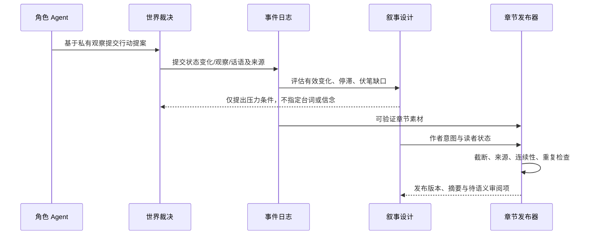

# 第一阶段实施结果

## 修改前四问与结果

| 问题 | 优先级/层 | 可验证质量提升 | 最小证明 |
|---|---|---|---|
| 保存设置会覆盖高级字段 | P0 配置 | 模拟与长文配置不再因局部表单保存而丢失 | 两个配置入口共用 merge；端点与纯函数测试 |
| 主角由 map 顺序决定 | P0 世界事实/写作 | 主角与 POV 必须显式或具有唯一旧标记 | 多实体循环解析测试；缺失/歧义拒绝 |
| 日志失败后状态已改变、非法路径静默成功 | P0 世界事实 | 副本归约，日志落盘并 sync 后才发布状态；未知字段拒绝 | 日志失败、部分失败、重放一致测试 |
| 角色请求获得全局资料，批量摘要混入多人记忆 | P1 角色认知 | 角色请求移除作者资料和工具；逐角色摘要/反思；观察按接收者和地点提交 | mock 捕获提示词与观察边界测试 |
| 编年史把事件框架和对话都当公开事实 | P1 世界事实/认知 | 观察、话语、作者候选分型；话语内容不自动等于事实 | occurrence 校验、来源 ID、受众过滤测试 |
| 模拟长期同义重复 | P1 叙事设计 | 每日按有来源的关系/资源/存活变化评估；连续三轮无证据则暂停并给压力候选 | 固定日志的三周期停滞测试 |
| 作者计划与事实/角色记忆混放 | P1 叙事设计 | 独立持久化主题、问题、秘密、伏笔、弧光、代价、信息差、章节有效变化和压力 | 非法兑现、未知事件、未发布读者知识拒绝测试 |
| 页面读取触发模型分章 | P0 写作 | GET 只读持久计划和文件状态 | HTTP GET 零模型调用且不创建计划测试 |
| 截断输出和伪摘要进入正式章节 | P0/P2 写作 | finish reason、结束标记、摘要、断句、来源和连续性成为发布门禁 | 多类不完整 mock 输出不生成文件 |
| 重试删除旧章节 | P0/P2 写作 | 当前投影、不可变版本、上一版备份分开；重复内容拒绝 | 连续发布保留两个版本、一个当前章测试 |

## 数据流

## 验证与边界

`go test ./...` 通过，未调用真实模型。覆盖配置保留、身份稳定、角色上下文隔离、日志失败不改状态、严格重放、截断不落盘、读取零模型调用、版本化增量发布和停滞识别。

第一阶段仍使用同一模型服务处理不同角色；隔离单位是独立请求、过滤后的上下文和独立记忆流，不是独立模型进程。旧记忆不能自动判定哪些句子已经污染。压力候选只提出条件，尚未自动转译并裁决为世界事件。事实、POV、伏笔公平性、人物弧光效果和节奏的语义审稿仍标为待审。

下一阶段应先做三件事：建立通用角色观察/传播事件；为压力候选增加批准、世界规则裁决和结果证据；用独立审稿请求输出逐项引用的事实与 POV 冲突报告。完成前不扩大 UI、插件、联网或部署范围。
