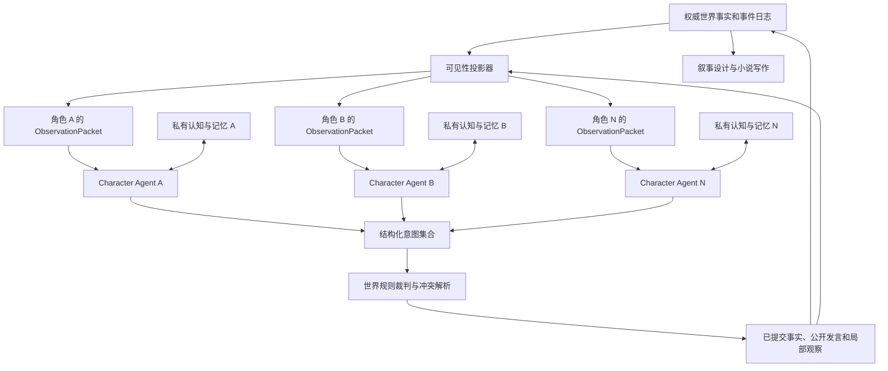

# 多角色 Agent Runtime 改造计划

状态：规划中。目标版本：Phase 2。本文修正此前把“角色数据隔离”表述为“角色独立思考”的错误。

逐项完成状态见 [执行清单](phase-2-checklist.md)。清单勾选以对应实现和验证通过为准。

## 1. 目标与完成定义

世界中存在 N 个可行动人物时，运行时自动建立 N 个逻辑 Character Agent。每个 Agent 必须拥有自己的角色身份、可见事实、信念、目标、计划、工作记忆、长期记忆、模型路由和调用审计。

世界 Agent 只生成环境条件和裁决角色提交的意图，不能替角色决定行动、生成台词或读取私密思考。叙事 Agent 只能读取已提交的世界事实和作者级规划，不能把作者意图注入角色。

完成后，“终局酒馆”五名人物应对应五个可观察的 Agent：

```text
沈砚 Agent  → 自己的观察、手牌、特权、记忆、计划 → 独立请求
罗绮 Agent  → 自己的观察、手牌、特权、记忆、计划 → 独立请求
顾闻 Agent  → 自己的观察、手牌、特权、记忆、计划 → 独立请求
叶晴 Agent  → 自己的观察、手牌、特权、记忆、计划 → 独立请求
程野 Agent  → 自己的观察、手牌、特权、记忆、计划 → 独立请求
```

使用相同模型不等于共享思维；同一模型也必须执行五次互不共享上下文的请求。角色数量、模型数量和 API Provider 数量是三个独立概念。

## 2. 当前架构需要替换的部分

当前流程是 `EventGenLLM → 主角决策 → 被选中的 NPCRespond → WorldAdvanceLLM`。只有主角拥有近似完整的决策步骤；NPC 只是事件触发后生成一句回复。`agents_memory.json` 虽然按角色分组，却由同一个 MemoryStore 管理，而且 NPC 没有持续的信念与计划状态。

需要替换：

- `Simulator.RunDay` 中固定的“主角决策 + 单个 NPC 对话”路径。
- `NPCRespond` 作为 NPC 主要行为入口的设计。
- Event Agent 直接替角色生成 observations 的权限。
- World Agent 可以直接替任意人物修改行动状态的宽权限。
- 单一 `*LLMClient` 向所有角色复用一套模型路由的方式。

可以保留：

- State Engine、Proposal、硬规则、事件日志和重放。
- 已增加的 Occurrence、Audience 与 SourceEvents。
- 世界书的作者层和公开规则层。
- 叙事状态、停滞检测、章节来源与版本化发布。
- 现有角色档案作为迁移输入。

## 3. 目标系统关系



### 一轮运行协议

1. 世界时钟建立不可变 `TurnSnapshot`。
2. 可见性投影器根据位置、公开事件、受众和传播记录，为每个角色生成不同的 `ObservationPacket`。
3. Agent Registry 选择本轮应唤醒的角色。
4. 每个被唤醒角色分别加载自己的认知状态和模型配置，发起独立模型请求。
5. 每个角色返回 `CharacterIntent`，包含可公开行动、可公开发言、前置条件和引用的观察来源。
6. 世界裁判验证所有意图，按场景模式解析冲突，并提交事件日志。
7. 每位角色只接收自己能够感知的结果，更新自己的信念、计划和记忆。
8. 叙事引擎从已发生事实评估推进、冲突和素材，不参与角色决策。

自由场景可在同一轮收集多个并行意图；严格回合制场景只激活当前行动者和需要回应的人。两种模式使用相同 Agent 接口。

## 4. Character Agent 数据边界

每个角色建立独立目录：

```text
worlds/{world}/agents/{character_id}/
  identity.json       # 身份、人设、重要性、模型覆盖
  cognition.json      # 当前目标、信念、假设、承诺、关系判断
  working_memory.jsonl
  long_term_memory.jsonl
  plans.json          # 私有短期计划与条件
  audit.jsonl         # 调用时间、模型、输入来源 ID、输出意图，不保存原始推理链
```

原始 chain-of-thought 不保存为世界事实或长期记忆。系统只保存可审计的结构化认知摘要：

```go
type CognitionState struct {
    Beliefs     []Belief
    Goals       []Goal
    Hypotheses  []Hypothesis
    Commitments []Commitment
    Plan        []PlannedAction
}
```

每项信念都包含来源事件、置信度和最后更新时间。角色可以相信错误信息，但不能在没有传播事件时知道其他人的秘密。

`CharacterIntent` 是世界裁判唯一接收的角色输出：

```go
type CharacterIntent struct {
    ActorID           string
    TurnID            string
    ActionType        string
    PublicAction      string
    PublicSpeech      string
    Parameters        map[string]any
    Preconditions     []IntentCondition
    ObservationSource []string
    Priority          int
}
```

私有信念更新与对外意图分开返回；世界裁判只读取意图。

## 5. 自动 Agent 分配

新增 `AgentRegistry.Reconcile(worldState)`：

- 扫描所有 `alive=true` 且可行动的实体。
- N 个可行动人物自动生成 N 个逻辑 Character Agent。
- 新角色提交进入世界后，在同一 revision 创建 Agent 数据分区。
- 角色死亡、离场或转为背景时，Agent 进入 dormant，保留记忆，不删除。
- 角色重新登场时恢复原 Agent，不重新创建人格。
- 注册过程幂等，使用 `world_id + character_id` 作为稳定标识。

自动重要性映射只在角色第一次出现时执行：

| 现有角色标记 | 默认重要性 |
|---|---|
| protagonist、rival、love_interest | core |
| important_npc、minor_npc | supporting |
| temporary_npc、walkon、mentioned | background |

用户修改后写入显式配置，后续自动同步不得覆盖。

运行时不为每个人永久占用 goroutine。Agent 是持久逻辑对象；调度器使用有界 worker pool，根据场景相关性唤醒，防止人物增加后同时打满所有 API。

## 6. 三档人物重要性

重要性控制成本、唤醒频率和默认模型，不改变角色是否拥有独立认知。

| 档位 | 中文 | 默认唤醒规则 | 上下文与记忆 | 推荐模型 |
|---|---|---|---|---|
| core | 核心人物 | 每个相关回合；主线场景始终唤醒 | 完整工作记忆、长期召回、计划与反思 | 强推理模型 |
| supporting | 重要配角 | 在场、被点名、承诺到期或目标受影响时 | 相关记忆、较短计划、周期性反思 | 标准模型 |
| background | 背景人物 | 直接卷入事件或收到传播时 | 小型工作记忆、无常驻反思 | 快速低成本模型 |

可在人物级覆盖默认模型。例如核心人物沈砚使用 Provider A 的模型，核心对手罗绮使用 Provider B 的模型。人物级覆盖优先级高于档位默认配置。

档位变化必须版本化记录。降低重要性不会删除记忆，提高重要性会在下次唤醒时生成新的认知摘要。

## 7. 多 API Provider 与模型路由

### 私密全局配置

扩展被 `.gitignore` 排除的 `api.json`：

```json
{
  "providers": {
    "deepseek-main": {
      "name": "DeepSeek",
      "protocol": "openai_compatible",
      "base_url": "...",
      "api_key": "...",
      "models": ["deepseek-chat", "deepseek-reasoner"],
      "timeout_seconds": 180,
      "max_parallel": 4,
      "extra_body": {}
    },
    "provider-b": {
      "name": "备用服务",
      "protocol": "openai_compatible",
      "base_url": "...",
      "api_key": "...",
      "models": ["model-x"],
      "max_parallel": 2
    }
  }
}
```

API Key 只存在全局私密配置；世界内的 `agent_runtime.json` 只保存 `provider_id + model_id` 引用。

### 世界级路由配置

```json
{
  "schema_version": 1,
  "tiers": {
    "core": {"provider_id": "deepseek-main", "model": "deepseek-reasoner"},
    "supporting": {"provider_id": "deepseek-main", "model": "deepseek-chat"},
    "background": {"provider_id": "provider-b", "model": "model-x"}
  },
  "characters": {
    "罗绮": {"importance": "core", "provider_id": "provider-b", "model": "model-x"}
  }
}
```

路由优先级：

1. 人物显式覆盖；
2. 人物重要性档位配置；
3. 全局默认 Provider；
4. 无可用配置时停止该 Agent，并返回可见错误，不静默切换模型替角色行动。

`ModelRouter` 按 Provider 分别执行并发限制、速率限制、超时和失败统计。失败回退必须由用户显式开启，审计中记录原模型、失败原因和实际回退模型。

## 8. 操作台设计

在 `worldweb` 操作台增加“角色 Agent”面板，分为三块。

### API Provider

- 添加、编辑和删除多个 Provider。
- 字段：名称、协议、Base URL、API Key、模型列表、超时、并发上限、extra_body。
- API Key 读取时永远返回掩码，不回传明文。
- “测试连接”只发最小请求，显示延迟、模型响应和错误原因。
- 支持手动填写模型；模型列表发现作为可选能力，不能阻塞配置。

### 档位配置

三行配置矩阵：核心人物、重要配角、背景人物。每行可选择：

- Provider；
- 模型；
- max_tokens；
- temperature；
- 上下文预算；
- 最大并发；
- 唤醒策略；
- 反思频率。

### 人物 Agent 表

| 人物 | 状态 | 重要性 | 实际 Provider/模型 | 覆盖 | 上次行动 | 记忆数 | Agent 状态 |
|---|---|---|---|---|---|---|---|

- 重要性下拉框：核心、重要配角、背景。
- 默认显示档位解析后的模型。
- 打开“人物覆盖”后可为该人物选择独立 Provider 和模型。
- 显示 `5 人物 = 5 Agent`，同时显示本轮实际唤醒数，避免把逻辑 Agent 数误解为并发请求数。
- 查看 Agent 时只展示结构化信念、目标、计划和来源，不展示原始推理链。
- 模拟运行中配置只读；保存新配置后从下一轮生效。

## 9. API 设计

```text
GET  /api/llm/providers
PUT  /api/llm/providers
POST /api/llm/providers/{id}/test

GET  /api/world/agents
GET  /api/world/agents/config
PUT  /api/world/agents/config
PUT  /api/world/agents/{character_id}
GET  /api/world/agents/{character_id}/cognition
GET  /api/world/agents/{character_id}/audit
POST /api/world/agents/reconcile
```

Provider GET 返回 `has_api_key: true/false`，不返回 Key。世界 Agent 配置 PUT 使用 revision 做乐观锁，防止运行中的旧页面覆盖新配置。

## 10. 实施阶段

### Phase 2A：配置与注册，不改变模拟行为

1. 增加 ProviderRegistry、ModelRef、AgentImportance、AgentRuntimeConfig。
2. 实现旧单 API 配置向默认 Provider 的兼容迁移。
3. 实现 AgentRegistry.Reconcile；现有角色自动生成 Agent 分区。
4. 增加只读 Agent 列表与配置 API。
5. 操作台加入 Provider、档位和人物分配界面。

验收：五个角色稳定显示五个 Agent；更改档位后解析到正确模型；API Key 不进入世界文件或 GET 响应。

### Phase 2B：独立认知与模型调用

1. 建立每角色独立目录和 CognitionStore。
2. 从旧 `agents_memory.json` 可逆迁移到角色目录，原文件保留备份。
3. 实现 VisibilityProjector，基于已提交 Occurrence 分发观察。
4. 实现 CharacterAgent.Think，严格按角色视图组装请求。
5. 实现 ModelRouter 和按 Provider 的有界 worker pool。

验收：在五名角色私有记忆中放入不同 canary，任何请求都不能同时出现两个角色的 canary；五次请求分别记录不同 actor、上下文哈希和模型路由。

### Phase 2C：意图、裁决和世界循环

1. 引入 CharacterIntent 与 TurnSnapshot。
2. 自由场景和回合制场景分别实现激活策略。
3. 世界裁判只接收意图，不读取角色私有认知。
4. 禁止 WorldAdvanceLLM 直接生成角色行动和台词。
5. 用意图结果替换 `ProtagonistDecideLLM + NPCRespond` 主流程。
6. 裁决结果经可见性投影后写入各角色记忆。

验收：终局酒馆中五人能够分别选择出牌、宣言、接受、质疑或使用特权；世界裁判只验证并结算；角色不知道未传播的手牌和特权。

### Phase 2D：叙事接入与运行观察

1. 叙事引擎只消费事实日志和公开/POV 可见材料。
2. 停滞压力转成环境条件，进入下一轮世界快照。
3. 操作台展示每轮 Agent 激活、意图、裁决、观察分发和成本。
4. 小说写手按 POV 读取可见信息，同时使用作者事实做一致性校验。

验收：小说能够利用角色自主行动形成的事实，同时不会把其他角色未公开的私密认知写进 POV 正文。

## 11. 核心不变量与验证

- 人物数等于已注册逻辑 Character Agent 数；死亡和离场 Agent 为 dormant，不删除。
- 每个模型请求只能包含一个角色的私有分区。
- 世界 Agent 不产生角色台词、私有信念或行动选择。
- Character Agent 不能直接写世界状态，只能提交 CharacterIntent。
- 任何记忆必须引用该角色实际收到的 Observation 或 Utterance。
- 人物重要性只影响资源分配，不取消自主性。
- 人物模型覆盖必须实际路由到指定 Provider，并写审计记录。
- Provider 密钥不进入 Git、世界目录、日志、前端响应或审计文件。
- Provider 故障不会被伪装成角色选择；该 Agent 明确失败、超时或按已配置策略回退。
- 相同世界事实和固定 mock 输出可重放出相同裁决结果。

## 12. 范围边界

本阶段不要求一个角色对应一个常驻进程，也不要求五个角色使用五种不同基础模型。先实现请求、上下文、认知、存储和权限的强逻辑隔离。进程级沙箱可以在协议稳定后增加，届时 Character Agent 接口无需改变。

不在此阶段重做小说 UI、图像生成、云部署、账户系统或多人协作。操作台只增加与 Agent 分配、Provider 路由、运行审计直接相关的界面。
