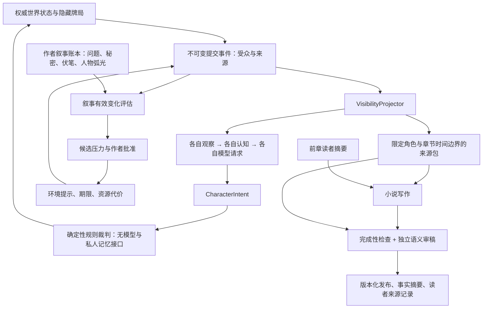

# 2D：叙事协调、运行观察与独立视角写作

## 修改前四问

1. 已确认问题：独立人物的结果尚未进入叙事评估；旧循环会重复请求或根据全局指标回档；写手读取全世界资料并将语义检查标为待审，可能泄露信息。
2. 优先级：P0 已有章节/配置安全、读取纯读；P1 事实到叙事与环境条件；P2 视角、来源、揭示和连续性审查。
3. 验证收益：环境代价可追溯且不能代替角色选择；作者可以观察每个角色的请求与记忆；写作及审稿请求不接收其他人的手牌、私密资料或未来回合的揭示。
4. 最小测试：固定事实、私密 canary、严格 JSON 意图、本地 HTTP / mock；失败审稿和截断不能形成正式版本，旧章节逐字不变。

## 决策

保留 StateEngine、日志、版本化章节发布器、叙事账本和兼容模式。新增明确的独立模式分流。写作模式和人物模型配置分开，人物三档不接管写手配置。

### 世界事实与叙事协调

`characteragent.AssessRuntime` 仅读已提交事件。按每轮确定性结果记录隐藏出牌承诺、质疑后的揭示和生命代价、接受风险、移动、资源转移。等待、重复观察、纯表达或失败行动不能自动证明新增可信事实/关系/目标进展。报告保存在派生文件 `narrative_runtime.json`，包含逐回合来源与原因，并保留 `narrative.json` 中未回收的作者条件；不会改写作者原计划。

三轮无有效变化后暂停模型请求。作者通过明确命令批准 `opportunity / deadline / resource_cost`。协调层要求已提交来源、受众、作者理由、有限期限和代价：提示进入观察；到期仅按公告扣减 `Entity.Money`，不足扣至0，记录实际结果。理由留在作者账本，不进入角色上下文。不改变牌、信念、台词或选择；不会把“某角色必须背叛”等作者目标当作角色指令。

候选不自动批准，资源是当前 `money` 槽位，尚未建立任意资源/条件 DSL、自动戏剧导演或全量人物弧光判定。判定“有规则支持的有效变化”不等于判定“情节精彩”。

### 作者运行观察

`GET /api/world/agents/runtime` 是纯读：脱敏场景状态、每人是否正在请求、最近行动、裁决、观察总数/当前世界版本新增观察、思考收据数、输入输出 Token 与最近推进证据。摘要不返回手牌、seed、秘密或私人思想。

角色 `cognition` 和 `audit` 接口仅由本地作者主动检查；不被角色运行时或写手调用。Token 从 received/incomplete 调用审计累计，使用量缺失时标记估算；没有接口返回用量的失败请求无法准确计费。不能把接到响应当作认知已成功提交。

### 小说写作与审稿

独立模式的 `PrepareIndependentSources` 复用严格可见性投影，从磁盘日志重建指定 POV 的来源，替代旧编年史文本作为权威输入。写作/审稿包只有本章视角已收到的观察、发言、持续规则，以及前章已发布读者摘要；不调用旧 `worldContext` / `characterIntro`，不读其他角色认知、全局世界书、未公开手牌或作者秘密。发言仍是表达证据，不提升为真相。未来回合与听不到的私话不会进入较早章节。

分章使用持久化确定性计划，独立分章零 LLM 调用；来源摘要覆盖具体观察内容和 POV。每个新章正常需要一次写作请求和一次 fast 档独立审稿请求。没有自动反复改写、模型发现或失败回退。正文使用 `NovelConfig()`；审稿不覆盖保存的长文预算与高级配置。

写作与审稿使用新的 `llm.CallIsolatedSync`，不使用旧客户端的 reasoning 兜底。与角色路由共用 `ValidateIsolatedExtraBody`，阻止消息/模型/预算覆盖与显式共享会话/历史字段；只发全新 system/user 请求，拒绝工具调用和 HTTP 重定向，远端错误不暴露响应原文或凭据。正常厂商生成参数仍保留，拒绝请求不会改写保存配置。本地 HTTP 测试覆盖正常正文、仅 reasoning、截断、工具、远端错误、坏格式、重定向及参数覆盖。

审稿明确检查事实、POV、连续性和揭示顺序，输出对应正文/来源摘要、逐项结论、问题及全部已核对来源。任一失败、未知来源、覆盖不全、错摘要、截断、格式异常或结束标记缺失，均不进入正式发布版本；错误显示具体审查维度与问题。通过后保存审查记录、摘要和来源，复用已有的版本归档与增量发布。旧章节不默认删除。

语义审查是模型判断，不是形式证明；文学节奏、人物弧光效果仍明确待审。不能据 mock 通过宣称真实小说已经更好。

## 文件与验证

| 层次 | 文件 | 验证 |
|---|---|---|
| 叙事设计/协调 | `characteragent/narrative.go`, `pressure.go` | 有来源的压力、精确扣减、重复不扣、作者理由不入上下文、角色继续自主等候 |
| 世界/认知观察 | `inspection.go`, `status.go`, `world_agent_inspection.go` | GET 不创建认知或调用模型，摘要没有隐藏牌局状态；世界切换请求拒绝 |
| 小说写作 | `novel/independent.go`, `publication.go` | 写作与审稿请求无全局/其他角色 canary；较早章没有未来揭示，私话按受众保留 |
| 发布 | `novel/independent_test.go` | 十一种截断/审查/来源/格式（含重复 JSON 键）失败均不替换用户旧章；成功版本带审稿与来源 |
| 前端 | `AgentRuntimePanel.svelte`, `agent-settings.browser.mjs` | 纯读开页、私人检查显式触发、环境条件的世界绑定、轮询不覆盖草稿、密钥不存浏览器 |

全量 Go test/build/vet、相关包 race、操作台配置单测、mock 浏览器回归及前端生产构建通过。前端仍有既有可访问性和大包体积警告。本轮未使用真实 API、未运行/迁移/重置用户世界。

## 仍需明确的边界

- 隔离是独立请求、白名单上下文和独立文件分区；没有每人一个 OS 进程或各自训练的模型实例。
- 普通自由世界仅支持有限规则动作，严格牌局是一个场景适配器；不是通用物理/游戏规则解释器。
- 作者问题、伏笔、秘密、人物弧光账本可持久化，但系统不会自动证明文学效果或自动完成整部长篇的设计。
- 固定 POV 死亡后不再获得新观察，不能全知补写终局；跨角色 POV 编排须显式设计新作品分支，不能自动随机换主角。
- 旧认知回档仍失败关闭：保留未来/分支不匹配数据，不自动删除或假装完整恢复。完整认知分叉恢复留待后续。
- `reflection_every` 暂存策略，不额外自动发起付费反思；目前需要模型用 `supersedes` 管理认知更新，长期超预算会报错。

本清单至 2D 完成后停止扩大实施范围；下一阶段应由用户按实际样本结果决定多 POV、作者级故事规划或更丰富的规则动作。
